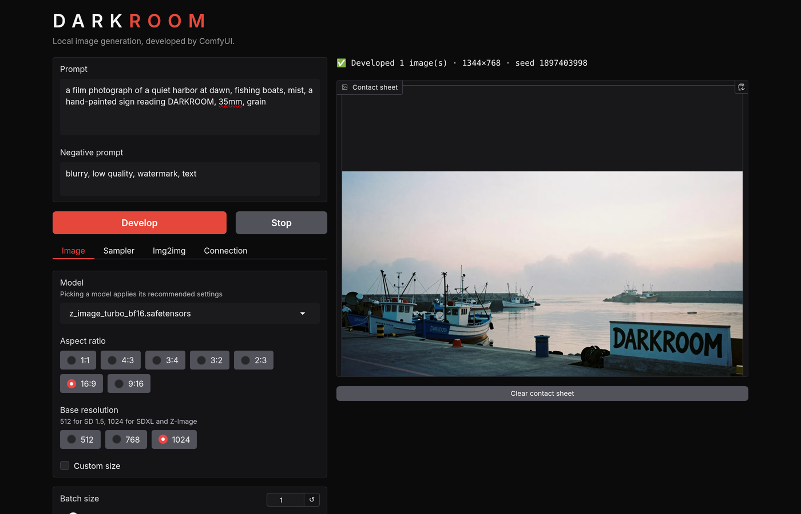

# Darkroom

A local image generation studio: a dark Gradio UI on top of a [ComfyUI](https://github.com/comfyanonymous/ComfyUI) backend.
Write a prompt, pick a checkpoint, and watch the image develop step by step.



## Features

- **txt2img and img2img** with any checkpoint ComfyUI can load (SD 1.5, SDXL, SD 3.5, and other single-file
  checkpoints)
  and with [Z-Image Turbo](https://huggingface.co/Tongyi-MAI/Z-Image-Turbo), which renders photoreal images and legible
  text in 8 steps, with [FLUX 3 Image Klein](https://bfl.ai/blog/flux-3-image-klein) from Black Forest Labs, and
  with [Qwen-Image 2.1](https://github.com/QwenLM/Qwen-Image), which is strong at typography and dense text, and
  with [MOSS-Image](https://github.com/OpenMOSS/MOSS-Image) (Apache 2.0), strong at long text and layouts, and
  with [Krea 2 Turbo](https://huggingface.co/krea/Krea-2-Turbo), an 8-step model built for aesthetic, stylized images,
  and with [Fibo 2.0](https://huggingface.co/briaai/Fibo-2.0-dev) from Bria (CC BY-NC), which generates from structured
  scene captions, with [Boogu Image 0.1](https://huggingface.co/Comfy-Org/Boogu-Image) Turbo (Apache 2.0), and with
  Microsoft's [Lens](https://huggingface.co/microsoft/Lens) (MIT), and with
  [HiDream O1](https://huggingface.co/HiDream-ai/HiDream-O1-Image) (MIT), which renders at about 4 MP, and with Baidu's
  [ERNIE-Image](https://huggingface.co/baidu/ERNIE-Image) (Apache 2.0), and with Meituan's
  [LongCat-Image](https://huggingface.co/meituan-longcat/LongCat-Image) (Apache 2.0)
- **Prompt expansion:** the FLUX 3 Klein and MOSS-Image upsamplers and the Krea 2 refiner (on by default) and Qwen-Image 2.1's prompt
  enhancer (off by default)
  turn a short prompt into a full scene caption, and Darkroom shows the expanded prompt
- **Instruction editing** with Qwen-Image 2.1, FLUX 3 Klein,
  [Fibo 2.0](https://huggingface.co/briaai/Fibo-2.0-dev),
  [JoyAI Image Edit](https://huggingface.co/jdopensource/JoyAI-Image-Edit) (Apache 2.0, edit only), Boogu Image 0.1 Edit,
  HiDream O1, LongCat-Image-Edit and
  [FireRed Image Edit 1.1](https://huggingface.co/FireRedTeam/FireRed-Image-Edit-1.1) (Apache 2.0, edit only): drop an
  image in the **Edit** tab and describe the change, such as *make it night time with rain*, optionally with more
  reference images
- **Model presets:** picking a model sets its recommended resolution, steps, CFG, sampler and scheduler
- **Live development:** a step-by-step progress bar and latent previews while the image renders
- **Aspect ratio sizing:** pick 1:1 to 16:9 and a base resolution (512, 768, 1024); Darkroom picks the
  pixel size, rounded to multiples of 64. Custom width and height are available too.
- **Every sampler and scheduler** your ComfyUI offers, plus steps, CFG, seed (random or fixed) and batches of up to 8
- **Stop** interrupts the running job in ComfyUI
- **Contact sheet:** every image of the session, newest first
- **Any backend:** ComfyUI on this machine, another GPU box, or a [Modal](https://modal.com) cloud GPU behind a token

- **Saved gallery:** every image is saved to `~/Pictures/Darkroom` (set `DARKROOM_OUTPUT_DIR` to change it) as a PNG
  with its prompt, model, seed and sampler settings embedded. The contact sheet shows that folder, newest first, so it
  survives restarts; click an image to see its file path and settings, and **Send to Edit** to load it in the Edit tab
  for another edit. Images you copy into the folder appear after
  **Refresh contact sheet**.

## Quick start

Requires Python 3.12+ and [uv](https://docs.astral.sh/uv/), plus a running ComfyUI (see below).

```sh
git clone <this repo> darkroom && cd darkroom
uv sync
uv run darkroom          # opens on http://127.0.0.1:7860
```

Darkroom connects to `http://127.0.0.1:8188` on startup. To use another ComfyUI, set `COMFYUI_URL` or change it in the
**Connection** tab and click **Connect / refresh models**.

## Backends

Darkroom only uses ComfyUI's HTTP and websocket API, so it doesn't matter where ComfyUI runs.

### ComfyUI on your own machine

```sh
git clone https://github.com/comfyanonymous/ComfyUI && cd ComfyUI
pip install torch torchvision torchaudio --index-url https://download.pytorch.org/whl/cu128  # NVIDIA GPU
pip install -r requirements.txt
python main.py --preview-method latent2rgb
```

Put `.safetensors` checkpoints in `ComfyUI/models/checkpoints`, then refresh models in Darkroom.

For SD 3.5, download `sd3.5_large_fp8_scaled.safetensors` (Large, 15 GB) and
`sd3.5_medium_incl_clips_t5xxlfp8scaled.safetensors` (Medium, 12 GB), both with their text encoders included, from
[Comfy-Org/stable-diffusion-3.5](https://huggingface.co/Comfy-Org/stable-diffusion-3.5) into
`ComfyUI/models/checkpoints`. Darkroom treats any checkpoint whose name contains `sd3` as SD 3.5 and samples the SD3
latent. Picking Large sets ComfyUI's template settings (20 steps, CFG 4, `euler`, `sgm_uniform`); picking Medium sets
the model card's 40 steps and CFG 4.5. SD 3.5 is under the Stability AI Community
License, which allows commercial use below USD 1 million in annual revenue.

SD 3.5 Large Turbo samples in 4 steps. Accept its license at
[stabilityai/stable-diffusion-3.5-large-turbo](https://huggingface.co/stabilityai/stable-diffusion-3.5-large-turbo)
(gated, approved at once) and download `sd3.5_large_turbo.safetensors` (16 GB) into `ComfyUI/models/checkpoints`. Its
checkpoint has no text encoders, so also download `clip_g.safetensors`, `clip_l.safetensors` and
`t5xxl_fp16.safetensors` from the `text_encoders` folder of Comfy-Org/stable-diffusion-3.5 (11 GB) into
`ComfyUI/models/text_encoders`. Picking it sets Stability's workflow settings: 4 steps, CFG 1, `dpmpp_2m`,
`sgm_uniform`.

For Z-Image Turbo, download the three files from
[Comfy-Org/z_image_turbo](https://huggingface.co/Comfy-Org/z_image_turbo/tree/main/split_files) (about 19 GB) into:

```
ComfyUI/models/diffusion_models/z_image_turbo_bf16.safetensors
ComfyUI/models/text_encoders/qwen_3_4b.safetensors
ComfyUI/models/vae/ae.safetensors
```

Darkroom lists any diffusion model whose name contains `z_image` and expects the text encoder and VAE under these
names. Z-Image needs a GPU with about 16 GB or more of VRAM at bf16.

Z-Image base (`z_image_bf16.safetensors` from
[Comfy-Org/z_image](https://huggingface.co/Comfy-Org/z_image/tree/main/split_files/diffusion_models), 12 GB) uses the
same text encoder and VAE. Picking it sets 25 steps and CFG 4, so the negative prompt takes effect; it is slower than
Turbo and more varied.

For FLUX 3 Image Klein, accept the license at
[black-forest-labs/flux-3-image-klein-comfy](https://huggingface.co/black-forest-labs/flux-3-image-klein-comfy)
(gated, FLUX Kommunity License) and download (about 38 GB):

```
ComfyUI/models/diffusion_models/flux3-image-klein-bf16.safetensors
ComfyUI/models/text_encoders/qwen3vl_4b_bf16.safetensors
ComfyUI/models/text_encoders/qwen3.5_9b_flux3_prompt_upsampler_bf16.safetensors
ComfyUI/models/vae/flux2-vae.safetensors
```

Darkroom lists any diffusion model whose name contains `flux3` and builds the graph from Black Forest Labs' ComfyUI
workflows. It needs ComfyUI 0.41 or later and, at bf16, a GPU with more than 24 GB of VRAM. The base checkpoint
(`flux3-image-klein-base-bf16.safetensors`) also works; picking it sets 50 steps and CFG 3.5.

For Qwen-Image 2.1, download from [Comfy-Org/Qwen-Image-2.1](https://huggingface.co/Comfy-Org/Qwen-Image-2.1)
(about 32 GB):

```
ComfyUI/models/diffusion_models/qwen_image_2.1_bf16.safetensors
ComfyUI/models/text_encoders/qwen3vl_8b_bf16.safetensors
ComfyUI/models/vae/qwen_image_2.1_vae_bf16.safetensors
```

Darkroom lists any diffusion model whose name contains `qwen_image` and builds the graph from ComfyUI's official
Qwen-Image 2.1 template (25 steps, CFG 1). Qwen-Image 2.1 is under the Qwen Research License, which allows
**non-commercial use only**.

Two optional extras from the same repo:

- **Turbo** (`diffusion_models/qwen_image_2.1_turbo_bf16.safetensors`, 14 GB): a distilled checkpoint that samples in
  8 steps on its own fixed schedule, so the Steps and Scheduler settings don't apply to it. In img2img, denoise picks
  how much of that schedule runs.
- **Prompt enhancer** (`text_encoders/qwen3.5_9b_qwen_image_2.1_pe_t2i.int8_convrot.safetensors`, 9.5 GB): tick
  **Expand prompt with the Qwen-Image enhancer** to have it rewrite your prompt first. It reasons before writing, as
  its model card recommends, which takes a few minutes per image (about 4 minutes on an L40S).
- **Edit prompt enhancer** (`text_encoders/qwen3.5_9b_qwen_image_2.1_pe_i2i.int8_convrot.safetensors`, 9 GB): the
  same toggle in edit mode. It looks at the images and turns a short instruction such as *make it snowy* into a
  detailed one that also says what to keep. An edit with it takes about 2.5 minutes on an L40S.

For MOSS-Image, download from [Comfy-Org/MOSS-Image](https://huggingface.co/Comfy-Org/MOSS-Image) (about 30 GB for
one checkpoint):

```
ComfyUI/models/diffusion_models/moss_image_sft_bf16.safetensors   (or moss_image_base_bf16.safetensors)
ComfyUI/models/text_encoders/qwen3.5_9b_bf16.safetensors
ComfyUI/models/vae/flux2-vae_small.safetensors
```

Darkroom lists any diffusion model whose name contains `moss_image` and builds the graph from ComfyUI's official
MOSS-Image templates: 25 steps, CFG 2.5, `er_sde`, `simple`, and skip-layer guidance for the Base checkpoint. The
text encoder doubles as the prompt upsampler, so expanding the prompt needs no extra download. MOSS-Image is under
Apache 2.0.

For editing, also download `loras/moss_image_edit_lora_rank_64_bf16.safetensors` into `ComfyUI/models/loras/`. Darkroom
then lists the SFT checkpoint a second time as `+ Edit LoRA` and builds the graph from ComfyUI's MOSS-Image edit
template: 30 steps at CFG 4 with layer 22 skipped, up to 10 images, no upsampler. Phrase edits as the LoRA was trained:
*Change only the X to Y. Keep the background and composition unchanged.* It handles object-level changes, such as a
color, material or garment, but ignored scene-wide changes like time of day and did not rewrite text.

For Ideogram 4, download from [Comfy-Org/Ideogram-4](https://huggingface.co/Comfy-Org/Ideogram-4) (about 27 GB);
it also uses the FLUX.2 VAE from the FLUX 3 files above:

```
ComfyUI/models/diffusion_models/ideogram4_fp8_scaled.safetensors
ComfyUI/models/diffusion_models/ideogram4_unconditional_fp8_scaled.safetensors
ComfyUI/models/text_encoders/qwen3vl_8b_fp8_scaled.safetensors
ComfyUI/models/vae/flux2-vae.safetensors
```

Darkroom lists `ideogram4` diffusion models (not the unconditional one, which it loads alongside) and builds the
graph from ComfyUI's template: the Ideogram 4 scheduler, CFG 7 against the unconditional model, dropping to 3 for the
last 30% of steps. Picking it sets 20 steps (the template's Default preset); 12 steps uses its Turbo schedule and 48
its Quality schedule. It has no negative prompt. Ideogram 4 is trained on structured JSON captions, and its built-in
safety filter blocks most plain prompts with an "Image blocked by safety filter" image. So **Expand prompt with the
Ideogram JSON captioner** is on by default: it rewrites your prompt into that JSON with the caption prompt from
ComfyUI's template, run on MOSS-Image's Qwen3.5 9B text encoder (`qwen3.5_9b_bf16.safetensors`, see MOSS-Image
above). Turn it off only when you write the JSON yourself; see Ideogram's
[prompting guide](https://github.com/ideogram-oss/ideogram4/blob/main/docs/prompting.md). Ideogram 4 is under the
Ideogram **non-commercial** model agreement.

For Ming Image 0.1 Design, a 6B model from inclusionAI tuned for UI screens, posters, infographics and other
text-heavy layouts (MIT), download (about 26 GB) from [Comfy-Org/Ming-Image](https://huggingface.co/Comfy-Org/Ming-Image):

```
ComfyUI/models/diffusion_models/ming_image_0.1_design_int8_convrot.safetensors
ComfyUI/models/text_encoders/ming_image_0.1_ling_mini_2.0_int8_convrot.safetensors
ComfyUI/models/vae/ming_image_vae_bf16.safetensors
```

Darkroom lists any diffusion model whose name contains `ming_image` and builds the graph from ComfyUI's templates:
12 steps without CFG (so no negative prompt), INT8 attention, and for text-to-image the authors' rewriter
(**Expand prompt with the Ming rewriter**, on by default) that turns a short idea into a layered layout caption. The
template runs the rewriter on Qwen3.8 27B, which writes about one token a second on an L40S, so an image would take
most of an hour; Darkroom runs it on MOSS-Image's Qwen3.5 9B text encoder (`qwen3.5_9b_bf16.safetensors`) instead.
Put the text you want rendered in quotes. Picking it sets 1024; the templates get their best quality at 2048. It also
edits, with up to 8 images; refer to them as *the first image*, *the second image*. Darkroom leaves out the repo's
Design-Layer model: it splits a finished design into RGBA layers from a layer plan, rather than generating or editing an
image, and ComfyUI has no workflow for it.

For [Mage-Flow](https://github.com/microsoft/Mage), Microsoft's compact 4B model (MIT), download (about 26 GB) from
[Comfy-Org/Mage-Flow](https://huggingface.co/Comfy-Org/Mage-Flow):

```
ComfyUI/models/diffusion_models/mage_flow_int8_convrot.safetensors              (text-to-image)
ComfyUI/models/diffusion_models/mage_flow_turbo_int8_convrot.safetensors        (text-to-image, 4 steps)
ComfyUI/models/diffusion_models/mage_flow_edit_int8_convrot.safetensors         (edit)
ComfyUI/models/diffusion_models/mage_flow_edit_turbo_int8_convrot.safetensors   (edit, 4 steps)
ComfyUI/models/text_encoders/mage_flow_qwen3vl_4b_bf16.safetensors
ComfyUI/models/vae/mage_flow_vae_bf16.safetensors
```

The text encoder is `text_encoders/qwen3vl_4b_bf16.safetensors` in that repo; it is a different file from FLUX 3's
encoder of the same name, so save it as `mage_flow_qwen3vl_4b_bf16.safetensors`. Darkroom lists any diffusion model
whose name contains `mage_flow` and builds the graph from ComfyUI's templates: 30 steps at CFG 5, or 4 steps at CFG 1
for Turbo. The `edit` checkpoints only edit, with up to 3 images, and the others only generate from text.

For [Krea 2 Turbo](https://huggingface.co/krea/Krea-2-Turbo) (Krea 2 Community License: commercial use only under
$1M annual revenue), download (about 18 GB) from [Comfy-Org/Krea-2](https://huggingface.co/Comfy-Org/Krea-2):

```
ComfyUI/models/diffusion_models/krea2_turbo_fp8_scaled.safetensors   (Turbo, 8 steps, CFG 1)
ComfyUI/models/diffusion_models/krea2_raw_fp8_scaled.safetensors     (Raw, 52 steps, CFG 3.5; about 13 GB more)
ComfyUI/models/text_encoders/krea2_qwen3vl_4b_fp8_scaled.safetensors
ComfyUI/models/vae/qwen_image_vae.safetensors
```

The text encoder is `text_encoders/qwen3vl_4b_fp8_scaled.safetensors` in that repo; save it as
`krea2_qwen3vl_4b_fp8_scaled.safetensors` so it cannot clash with other Qwen3-VL 4B files. The VAE is the same file
FireRed uses. Darkroom lists any diffusion model whose name contains `krea2` and builds the graph from ComfyUI's
template: 8 steps at CFG 1 against a zeroed negative. Raw, the undistilled model, has no template; it runs the same graph
at its model card's 52 steps and CFG 3.5 with the negative prompt. The template's prompt refiner, run on Krea's own text encoder, is on by default; it keeps
the scene but adds a no-text clause unless you quote the words to render.

For [Fibo 2.0](https://huggingface.co/briaai/Fibo-2.0-dev) from Bria (CC BY-NC 4.0: non-commercial use only), which
generates from text and edits, download (about 17 GB) from [Comfy-Org/Fibo-2.0](https://huggingface.co/Comfy-Org/Fibo-2.0):

```
ComfyUI/models/diffusion_models/fibo2_dev_int8_convrot.safetensors           (50 steps, CFG 5)
ComfyUI/models/diffusion_models/fibo2_edit_turbo_int8_convrot.safetensors    (4 steps, CFG 1)
```

It also needs Mage-Flow's text encoder (`mage_flow_qwen3vl_4b_bf16.safetensors`; Fibo's `qwen3vl_4b_bf16.safetensors` is
the same file), FLUX 3's `flux2-vae.safetensors`, and for its prompt enhancer Ideogram 4's
`qwen3vl_8b_fp8_scaled.safetensors` (the template uses the int8 file of the same Qwen3-VL 8B). Darkroom lists any
diffusion model whose name contains `fibo2` and builds the graph from ComfyUI's Fibo 2.0 edit templates; without an
image in the Edit tab the same models generate from text (ComfyUI has no local text-to-image template for Fibo yet).
Fibo reads structured VGL captions, so the enhancer (on by default) rewrites the prompt into one: for edits with the
template's prompt, which also looks at the images, and for text-to-image with the `generate` prompt from Bria's
[VGL library](https://github.com/Bria-AI/vgl) (MIT) plus the template's additions. Keep it on: without it, Fibo tends
to render words of the prompt as text in the image. In edits, describe the final result, not what to keep. Dev uses Bria's structured negative and ignores the negative prompt box;
Turbo runs without one. Refer to several images as `<image_1>`, `<image_2>`. On an L40S, Dev takes about 2 minutes
for an image and 4 for an edit; Turbo takes about 10 seconds, or 30 to 45 seconds with the enhancer.

For [JoyAI Image Edit](https://huggingface.co/jdopensource/JoyAI-Image-Edit) from JD (Apache 2.0), an edit-only model,
download (about 25 GB) from [Comfy-Org/JoyAI-Image-Edit](https://huggingface.co/Comfy-Org/JoyAI-Image-Edit):

```
ComfyUI/models/diffusion_models/joyai_image_edit_int8_convrot.safetensors
ComfyUI/models/text_encoders/qwen3vl_8b_joyimage_edit_int8_convrot.safetensors
ComfyUI/models/vae/wan_2.1_vae.safetensors
```

Darkroom lists any diffusion model whose name contains `joyai` and builds the graph from ComfyUI's template: 40 steps
at CFG 4 with CFGNorm, `euler` and `normal`. It takes up to 6 images. It is slow: about 4 minutes an edit on an L40S.

For [Boogu Image 0.1](https://huggingface.co/Comfy-Org/Boogu-Image) (Apache 2.0), download (about 43 GB) from
[Comfy-Org/Boogu-Image](https://huggingface.co/Comfy-Org/Boogu-Image):

```
ComfyUI/models/diffusion_models/boogu_image_turbo_fp8_scaled.safetensors     (text-to-image, 4 steps)
ComfyUI/models/diffusion_models/boogu_image_base_fp8_scaled.safetensors      (text-to-image, 30 steps, CFG 4)
ComfyUI/models/diffusion_models/boogu_image_edit_int8_convrot.safetensors    (edit)
ComfyUI/models/diffusion_models/boogu_image_edit_turbo_hotfix_1k_20260708_int8_convrot.safetensors   (edit, 4 steps)
```

It also needs Ideogram 4's text encoder (`qwen3vl_8b_fp8_scaled.safetensors`, the same file as Boogu's) and Z-Image's
`ae.safetensors` VAE. Darkroom lists any diffusion model whose name contains `boogu` and builds the graph from ComfyUI's
templates: Turbo runs 4 `lcm` steps at CFG 1 with `sgm_uniform`; the edit checkpoint runs 25 `dpmpp_2m` steps at CFG
3.5 with a shift of 3.16. Base and Edit Turbo have no template; they run the edit template's sampler at their model
card's settings (Base 30 steps at CFG 4 with the negative prompt; Edit Turbo, the 1K hotfix Boogu recommends, 4 steps at
CFG 1). The edit checkpoints only edit, and the others only generate from text. On an L40S, Turbo and Edit Turbo take
under 30 seconds, Base under a minute, and an edit about 2 minutes.

For [Lens](https://huggingface.co/microsoft/Lens) from Microsoft (MIT), download (about 30 GB) from
[Comfy-Org/Lens](https://huggingface.co/Comfy-Org/Lens):

```
ComfyUI/models/diffusion_models/lens_bf16.safetensors          (20 steps, CFG 5)
ComfyUI/models/diffusion_models/lens_turbo_bf16.safetensors    (4 steps, CFG 1)
ComfyUI/models/text_encoders/gpt_oss_20b_nvfp4.safetensors
ComfyUI/models/vae/lens_flux2-vae.safetensors
```

The VAE is `vae/flux2-vae.safetensors` in that repo; it is a different file from FLUX 3's VAE of the same name, so save
it as `lens_flux2-vae.safetensors`. Darkroom lists any diffusion model whose name starts with `lens_` and builds the
graph from ComfyUI's templates: a Flux-style shift, CFGNorm, `euler` and `simple`. The templates use a 1440 base
resolution; picking Lens sets 1024, which is faster. The NVFP4 text encoder also runs on GPUs without FP4 support, such
as the L40S.

For [HiDream O1](https://huggingface.co/HiDream-ai/HiDream-O1-Image) (MIT), download the checkpoints (about 24 GB)
from [Comfy-Org/HiDream-O1-Image](https://huggingface.co/Comfy-Org/HiDream-O1-Image), and for its optional prompt
refiner Gemma 4 E4B (9 GB) from [Comfy-Org/gemma-4](https://huggingface.co/Comfy-Org/gemma-4):

```
ComfyUI/models/checkpoints/hidream_o1_image_bf16.safetensors               (40 steps, CFG 5)
ComfyUI/models/checkpoints/hidream_o1_image_dev_fp8_scaled.safetensors     (28 steps, CFG 1)
ComfyUI/models/text_encoders/gemma4_e4b_it_fp8_scaled.safetensors
```

Darkroom lists any checkpoint whose name contains `hidream_o1` and builds the graph from ComfyUI's templates. The same
checkpoints generate from text and edit. HiDream O1 is trained at about 4 MP, so picking it sets the 2048 base
resolution; edits at 1024 came out as noise. The refiner (off by default, as in the templates) rewrites the prompt
with the template's instructions; Darkroom runs it for text-to-image only, because for edits it cannot see the image and
rewrote the instruction into a new scene. On an L40S at 2560×1440, Dev takes about 15 seconds for an image and 35 for an
edit; the full model about a minute.

For [ERNIE-Image](https://huggingface.co/baidu/ERNIE-Image) from Baidu (Apache 2.0), download (about 37 GB) from
[Comfy-Org/ERNIE-Image](https://huggingface.co/Comfy-Org/ERNIE-Image):

```
ComfyUI/models/diffusion_models/ernie-image.safetensors                     (20 steps, CFG 4)
ComfyUI/models/diffusion_models/ernie-image-turbo.safetensors               (8 steps, CFG 1)
ComfyUI/models/text_encoders/ministral-3-3b.safetensors
ComfyUI/models/text_encoders/ernie-image-prompt-enhancer.safetensors
```

Its VAE, `vae/flux2-vae.safetensors` in that repo, is the same file as Lens's; save it as `lens_flux2-vae.safetensors`.
Darkroom lists any diffusion model whose name contains `ernie-image` and builds the graph from ComfyUI's templates.
Its prompt enhancer, on by default as in the templates, gets the prompt and the canvas size and writes the expanded
caption in Chinese, which ERNIE-Image reads natively.

For [LongCat-Image](https://huggingface.co/meituan-longcat/LongCat-Image) from Meituan (Apache 2.0), download (about
38 GB) from [Comfy-Org/LongCat-Image](https://huggingface.co/Comfy-Org/LongCat-Image):

```
ComfyUI/models/diffusion_models/longcat_image_bf16.safetensors              (text-to-image, 20 steps, CFG 4)
ComfyUI/models/diffusion_models/longcat_image_edit_bf16.safetensors         (edit, 50 steps, CFG 4.5)
ComfyUI/models/diffusion_models/longcat_image_edit_turbo_bf16.safetensors   (edit, 8 steps, CFG 1)
```

It uses FireRed's `qwen_2.5_vl_7b_fp8_scaled.safetensors` text encoder and Z-Image's `ae.safetensors` VAE. Darkroom lists
any diffusion model whose name contains `longcat_image` and builds the graphs from ComfyUI's text-to-image and edit
templates; Edit Turbo has no template and runs the edit graph with its model card's 8 steps at CFG 1. The edit models
take one image and only edit; the other only generates from text. They render new text in edits poorly.

For [Anima](https://huggingface.co/circlestone-labs/Anima), an anime and illustration model from CircleStone Labs
and Comfy Org (non-commercial license; the images you make may be used commercially), download (about 14 GB) from
that repo:

```
ComfyUI/models/diffusion_models/anima-base-v1.0.safetensors        (30 steps, CFG 4)
ComfyUI/models/diffusion_models/anima-aesthetic-v1.1.safetensors   (30 steps, CFG 4)
ComfyUI/models/diffusion_models/anima-turbo-v1.1.safetensors       (8 steps, CFG 1)
ComfyUI/models/text_encoders/qwen_3_06b_base.safetensors
```

Its VAE is FireRed's `qwen_image_vae.safetensors`. Darkroom lists any diffusion model whose name starts with `anima-`
and builds the graph from ComfyUI's Anima Base template, with the Turbo settings from its model card; img2img works
too. It reads Danbooru-style tags, natural language, or both: start the prompt with `masterpiece, best quality, safe,`
and use its card's negative, `worst quality, low quality, artist name, blurry, jpeg artifacts, chromatic aberration`.
It does not do photorealism.

For [Kandinsky 5.0 Image Lite](https://huggingface.co/kandinskylab/Kandinsky-5.0-T2I-Lite) from Kandinsky Lab (MIT),
download (about 24 GB) from that repo and
[Kandinsky-5.0-T2I-Lite-pretrain](https://huggingface.co/kandinskylab/Kandinsky-5.0-T2I-Lite-pretrain):

```
ComfyUI/models/diffusion_models/kandinsky5lite_t2i.safetensors            (SFT, 50 steps, CFG 3.5)
ComfyUI/models/diffusion_models/kandinsky5lite_t2i_pretrain.safetensors   (pretrain, the same settings)
```

It uses FireRed's `qwen_2.5_vl_7b_fp8_scaled.safetensors` and SD 3.5's `clip_l.safetensors` as text encoders and
Z-Image's `ae.safetensors` VAE. Darkroom lists any diffusion model whose name contains `kandinsky5lite_t2i` and builds
the graph from ComfyUI's template; img2img works too. ComfyUI cannot run the I2I (edit) checkpoint, so Darkroom leaves
it out.

For [PixelDiT](https://huggingface.co/nvidia/PixelDiT-1300M-1024px) from NVIDIA (NSCL v1: non-commercial), a 1.3B
model that samples pixels directly with no VAE, download (about 8 GB) from
[Comfy-Org/PixelDiT](https://huggingface.co/Comfy-Org/PixelDiT):

```
ComfyUI/models/diffusion_models/pixeldit_1300m_1024px_bf16.safetensors   (30 er_sde steps, CFG 4)
ComfyUI/models/text_encoders/gemma_2_2b_it_elm_bf16.safetensors
```

Darkroom lists any diffusion model whose name starts with `pixeldit_` and builds the graph from ComfyUI's template;
img2img works too. It renders text poorly. The `pid_*` files in that repo are PiD decoders that upscale other models'
latents to 4K, not image models, so Darkroom does not list them.

For [MiniMax-H3-Image](https://huggingface.co/Comfy-Org/MiniMax-H3-Image), text-to-image and edit in one model,
**check its license first**: it excludes the EU, the UK, South Korea and the United States, including using or
displaying its outputs there. Download (about 55 GB) from that repo, [Comfy-Org/MiniMax-H3](https://huggingface.co/Comfy-Org/MiniMax-H3)
and [Comfy-Org/Qwen3.5](https://huggingface.co/Comfy-Org/Qwen3.5):

```
ComfyUI/models/diffusion_models/minimax_h3_image_pruned_int8_convrot.safetensors   (6 steps, CFG 1)
ComfyUI/models/text_encoders/qwen3vl_32b_minimax_h3_int8_convrot.safetensors
ComfyUI/models/text_encoders/qwen3.5_9b_w4a8_gptq.safetensors                      (prompt enhancer)
ComfyUI/models/vae/minimax_h3_image_vae_fp16.safetensors
```

Darkroom lists any diffusion model whose name contains `minimax_h3_image` and builds the graphs from ComfyUI's
text-to-image and edit templates at about 4 MP (the 2048 base resolution, which picking it sets) in multiples of 32.
In edits, refer to the images as `<Picture 1>`, `<Picture 2>`; the first is the one to edit. Its prompt enhancer, on
by default, reasons before it writes the caption, so it adds time; for edits it also sees the image to edit. It has no
img2img. The Modal app below keeps H3 out of the excluded territories. Darkroom's H3 support has not been tested yet.

For FireRed Image Edit 1.1, an edit-only model, download (about 48 GB) from
[FireRed-Image-Edit-1.1-ComfyUI](https://huggingface.co/FireRedTeam/FireRed-Image-Edit-1.1-ComfyUI),
[FireRed-Image-Edit-1.0-ComfyUI](https://huggingface.co/FireRedTeam/FireRed-Image-Edit-1.0-ComfyUI) and
[HunyuanVideo_1.5_repackaged](https://huggingface.co/Comfy-Org/HunyuanVideo_1.5_repackaged/tree/main/split_files/text_encoders):

```
ComfyUI/models/diffusion_models/FireRed-Image-Edit-1.1-transformer.safetensors
ComfyUI/models/loras/FireRed-Image-Edit-1.0-Lightning-8steps-v1.0.safetensors      (optional)
ComfyUI/models/text_encoders/qwen_2.5_vl_7b_fp8_scaled.safetensors
ComfyUI/models/vae/qwen_image_vae.safetensors
```

Darkroom lists any diffusion model whose name contains `firered` and builds the graph from ComfyUI's official
template: 40 steps at CFG 4, or 8 steps at CFG 1 when you pick the **+ Lightning** entry, which Darkroom adds when
the Lightning LoRA is installed. FireRed is under Apache 2.0.

Apple Silicon works through PyTorch's MPS backend with the default torch install.
Without a GPU, install the CPU build of torch and start ComfyUI with `--cpu`. That works but is slow: a 512×512
SD 1.5 image takes several minutes, and the model needs about 6 GB of free RAM.

### ComfyUI on a Modal cloud GPU

[`modal_comfyui.py`](modal_comfyui.py) runs ComfyUI on an NVIDIA L40S (48 GB). ComfyUI has no login of its own, so
the endpoint requires a Modal proxy token. The container shuts down after 5 idle minutes, so you pay only while
generating.

```sh
uv sync --extra modal
uv run modal setup                                           # once: sign in to Modal
uv run modal run modal_comfyui.py::download                  # SD 1.5, SDXL and the newest models into a Volume
uv run modal deploy modal_comfyui.py                         # prints https://<workspace>--darkroom-comfyui-comfyui.<region>.modal.run
uv run modal workspace proxy-tokens create --name darkroom   # prints a token ID (wk-…) and secret (ws-…), shown only once

export COMFYUI_URL=https://<workspace>--darkroom-comfyui-comfyui.<region>.modal.run
export COMFYUI_TOKEN=wk-….ws-…                               # token ID and secret joined with a dot
uv run darkroom
```

- **More checkpoints:** `uv run modal run modal_comfyui.py::download --extra "owner/repo/file.safetensors,..."`,
  using Hugging Face repo and file names.
- **Another GPU:** `DARKROOM_GPU=A10G uv run modal deploy modal_comfyui.py`.
- **Timing:** the first request after an idle period starts the GPU, which takes about 1 to 2 minutes. After that,
  on the L40S, SD 1.5 at 512×512 with 25 steps takes about 2.5 s, SDXL at 1024×1024 with 30 steps about 15 s,
  Z-Image Turbo at 1024×1024 with 8 steps about 4 s, and FLUX 3 Klein at 16 steps about 5.5 s, or about 14 s with
  the prompt upsampler.
- **New models need a fresh container:** a running container only sees the Volume as it was when it started. After
  the download step, stop it so the next request starts one that lists the new files:
  `uv run modal container list`, then `uv run modal container stop -y <container id>`.
- **MiniMax-H3-Image:** [`modal_h3.py`](modal_h3.py) is a separate app with its own Volume. Its GPU (H100 by default,
  `DARKROOM_H3_GPU` to change) runs only in Japan or Canada, and requests route through Mumbai. Pinned regions cost
  1.75× Modal's base price, and Modal still stores every Volume in the United States. Run Darkroom on your own machine
  in a country the license allows, and point its Connection tab at this app's URL:
  `uv run modal run modal_h3.py::download`, then `uv run modal deploy modal_h3.py`. The proxy token works for both apps.
- **FLUX 3 download:** the repo is gated. Accept its license on Hugging Face and store a token as a Modal secret
  named `huggingface` (`uv run modal secret create huggingface HF_TOKEN=hf_...`) before running the download step.

## Configuration

| Variable        | Default                  | Meaning                                                              |
|-----------------|--------------------------|----------------------------------------------------------------------|
| `COMFYUI_URL`   | `http://127.0.0.1:8188`  | ComfyUI server (also editable in the Connection tab)                 |
| `COMFYUI_TOKEN` | unset                    | Bearer token for a ComfyUI behind an auth proxy, such as Modal's     |
| `DARKROOM_HOST` | `127.0.0.1`              | Interface to listen on; use `0.0.0.0` to reach it from other devices |
| `DARKROOM_OUTPUT_DIR` | `~/Pictures/Darkroom` | Folder where images are saved and that the contact sheet shows |
| `DARKROOM_PORT` | `7860`                   | Port to listen on                                                    |
| `DARKROOM_GPU`  | `L40S`                   | Modal GPU type, read by `modal deploy modal_comfyui.py`              |

## Tips

- Use base resolution 512 for SD 1.5 and 1024 for SDXL, SD 3.5 and Z-Image; other sizes give duplicated subjects or blurry
  results. Picking a model sets this for you.
- Z-Image Turbo, the distilled FLUX 3 Klein and Qwen-Image 2.1 (base and Turbo) run at CFG 1, where the negative prompt has no effect. Describe what
  you want in the prompt instead.
- MOSS-Image uses its negative prompt (CFG 2.5). Its recommended one is
  `nsfw, worst quality, bad anatomy, watermark, jpeg artifact`; drop `text` from the default negative when you want
  lettering in the image.
- With FLUX 3, keep the upsampler on for short prompts. Turn it off only when you write a full scene caption yourself;
  the **Expanded prompt** box shows what a good one looks like.
- Press Enter in the prompt box to develop.
- For img2img, drop an image in the **Img2img** tab. It is scaled and center-cropped to the chosen size.
  Lower denoise keeps more of the original.
- For edits, pick Qwen-Image 2.1, FLUX 3 Klein or FireRed Image Edit, drop the image in the **Edit** tab and write
  the change as the prompt. The output keeps the image's aspect ratio at the chosen base resolution (1 MP with
  FireRed). To combine images, add them under **More reference images** and refer to them as `<image1>`, `<image2>`,
  … with Qwen-Image, as *the first image*, *the second image* with FLUX 3, or as *Picture 1*, *Picture 2* with
  FireRed, which takes up to 3 images; the image to edit is the first. Say where things go in terms of what the scene
  holds; an instruction the scene can't satisfy, such as a wall that isn't there, gets reinterpreted. With Qwen-Image,
  **Expand prompt** runs its edit enhancer. Edit can't be combined with Img2img. On the L40S a 1 MP edit takes about
  20 s with Qwen-Image Turbo or FLUX 3 without the upsampler, and about 50 to 60 s with Qwen-Image base or the FLUX 3
  upsampler.
- Turn off **Random seed** to reuse the seed shown in the status line and vary only the prompt.

## Troubleshooting

| Symptom | Cause and fix |
|---|---|
| 🔴 Cannot reach ComfyUI | ComfyUI isn't running at `COMFYUI_URL`, or the URL is wrong. |
| New model missing on Modal | The running container predates the download. Stop it (see the Modal section). |
| 0 models | No models in `ComfyUI/models/checkpoints` (or `diffusion_models` for Z-Image). Add one and click **Connect / refresh models**. |
| SD 3.5 Large Turbo: value not in list | A text encoder `clip_g`, `clip_l` or `t5xxl_fp16` is missing. See the SD 3.5 files above. |
| FireRed: value not in list | The text encoder `qwen_2.5_vl_7b_fp8_scaled.safetensors` or VAE `qwen_image_vae.safetensors` is missing. |
| MOSS-Image: value not in list | The text encoder `qwen3.5_9b_bf16.safetensors` or VAE `flux2-vae_small.safetensors` is missing. |
| Qwen-Image: value not in list | The text encoder `qwen3vl_8b_bf16.safetensors` or VAE `qwen_image_2.1_vae_bf16.safetensors` is missing. |
| FLUX 3: value not in list | A FLUX 3 text encoder, upsampler or VAE is missing. See the FLUX 3 files above. |
| Z-Image: value not in list | The text encoder `qwen_3_4b.safetensors` or VAE `ae.safetensors` is missing. See the Z-Image files above. |
| 🔴 Lost connection to ComfyUI | ComfyUI stopped mid-job, usually because it ran out of memory. Check its console; try a smaller size or batch. |
| HTTP 401 from Modal | `COMFYUI_TOKEN` is missing or wrong. It must be `wk-…` and `ws-…` joined with a dot. |
| First Modal image is slow | The GPU container is starting. Later images are fast until it has been idle for 5 minutes. |

## Project layout

```
src/darkroom/app.py      Gradio UI and generation flow
src/darkroom/comfy.py    ComfyUI client (HTTP + websocket) and workflow builder
src/darkroom/flux3_upsampler_prompt.txt  BFL's system prompt for the FLUX 3 upsampler (MIT)
src/darkroom/flux3_edit_upsampler_prompt.txt  BFL's system prompt for the FLUX 3 upsampler in edits (MIT)
src/darkroom/qwen_image_pe_prompt.txt    system prompt for the Qwen-Image 2.1 prompt enhancer (ComfyUI template)
src/darkroom/qwen_image_edit_pe_prompt.txt  system prompt for the Qwen-Image 2.1 edit enhancer (ComfyUI template)
src/darkroom/moss_image_pe_prompt.txt    system prompt for the MOSS-Image upsampler (ComfyUI template)
src/darkroom/ideogram4_pe_prompt.txt     system prompt for the Ideogram 4 JSON captioner (ComfyUI template)
src/darkroom/ming_image_pe_prompt.txt    system prompt for the Ming Image rewriter (ComfyUI template)
modal_comfyui.py         ComfyUI on a Modal GPU
modal_h3.py              ComfyUI with MiniMax-H3-Image on a Modal GPU in Japan or Canada
```

See [CHANGELOG.md](CHANGELOG.md) for release notes.
